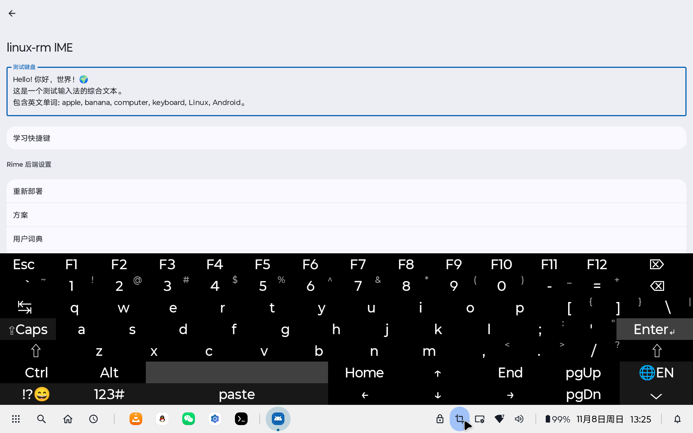
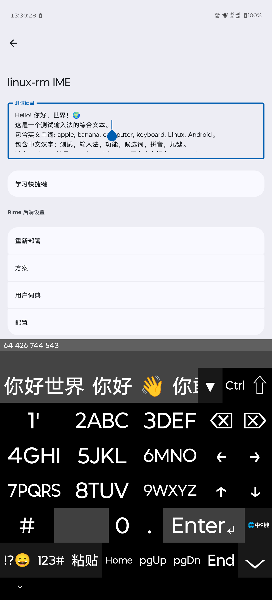
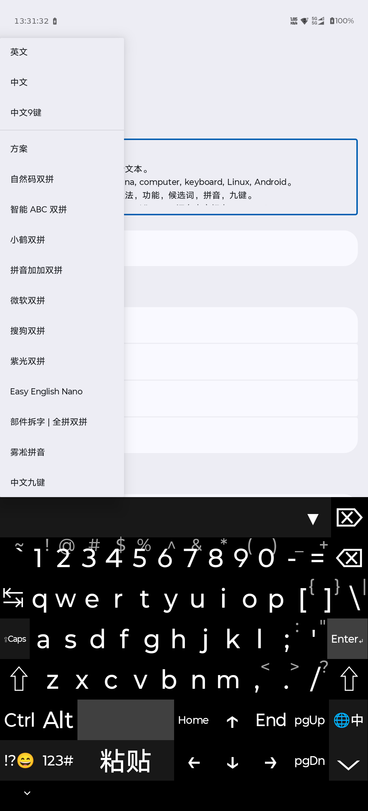
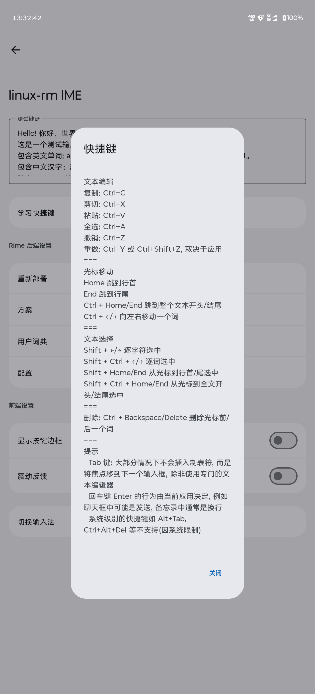
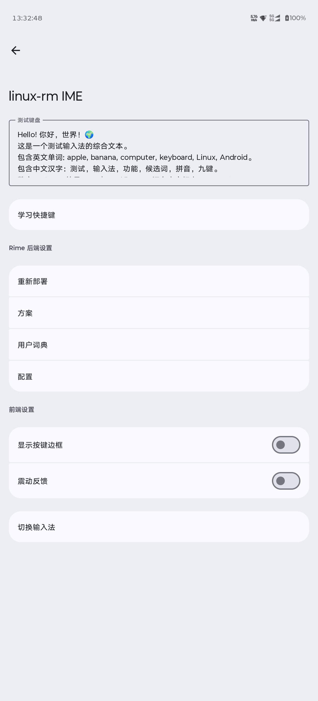

# Linux-rm IME

**Linux-rm IME** 是一个 Android 输入法（IME），模拟完整的 PC 键盘布局，中文输入由 [Rime](https://github.com/rime/librime) 驱动。它提供类似物理键盘的打字体验，支持修饰键（Shift、Ctrl、Alt）、数字小键盘模式、功能键行、符号输入，以及基于 Rime 的中文输入候选栏。

平板：



手机：



## 功能

- **完整 PC 键盘布局** – 字母、数字、符号、F1–F12、方向键、Home/End、Page Up/Down 等。
- **修饰键** – Shift（粘滞/锁定）、Ctrl、Alt；支持 Ctrl+A、Ctrl+C、Ctrl+V 等组合。
- **功能键行** – 英文模式下顶行为 Esc 和 F1–F12。
- **数字小键盘模式** – 切换到带运算符和导航键的小键盘布局。
- **大写锁定** – 屏幕指示，映射到系统大写状态。
- **通过 Rime 的中文输入** – 拼音和 T9（九键）模式、方案切换、用户词典、候选选择与删除。
- **英文模式** – 普通 PC 键盘布局；按键直接提交或作为按键事件发送，不经过 Rime。
- **符号输入** – 分类符号选择器，从 `res/raw/symbols.csv` 加载。
- **候选栏** – 在中文和 T9 模式下显示 Rime 候选；在英文、密码和数字输入框中隐藏。
- **编辑辅助** – 有一键粘贴键；其他通过 Ctrl+A / Ctrl+C / Ctrl+X 全选 / 复制 / 剪切。
- **自适应布局** – 在数字输入框中自动切换为数字键盘，在密码输入框中隐藏 Rime 功能。
- **前端设置** – 切换按键边框和触感反馈。Rime 配置 / 重新部署 / 用户词典 / 方案控制已计划但尚未实现。
- **轻量运行时** – 无额外运行时服务；Rime 作为原生库编译进应用。

## 环境要求

- **Android 6.0+**（`minSdk 23`）
- **JDK 21**（项目工具链）
- **Android SDK 37**（`compileSdk` / `targetSdk`）
- **Android NDK + CMake**（用于构建原生 Rime 后端）
- 支持的 ABI：`arm64-v8a`、`x86_64`

## 构建与安装

### 1. 带子模块克隆

> **中国大陆用户注意：** 主仓库在 Gitee，但子模块和 Boost 在 GitHub。如果克隆卡住，先配置镜像：
>
> ```bash
> git config --global url."https://v4.gh-proxy.org/https://github.com/".insteadOf "https://github.com/"
> ```

子模块：`librime/deps/*`（glog、leveldb、yaml-cpp、googletest、marisa-trie、OpenCC）、`snappy`，以及 `jni/OpenCC`。

```bash
git clone --recurse-submodules https://gitee.com/linux-rm/linux-rm-IME.git
```

- 或者，如果已经克隆过：

```bash
git submodule update --init
```

### 2. 获取 Boost

Boost 未随仓库提供。必须克隆到 `app/src/main/jni/boost`：

```bash
cd app/src/main/jni
rm -rf boost
git clone --depth 1 --recurse-submodules https://github.com/boostorg/boost.git boost
```

Boost 有很多子模块；首次克隆可能需要几分钟。

如果 Boost 缺失或不完整，CMake 会在 Gradle 构建期间中止并给出明确错误信息。

### 3. 构建

在 Android Studio 中打开项目，或从命令行构建：

```bash
./gradlew assembleDebug
```

APK 生成于 `app/build/outputs/apk/debug/`。

### 4. 安装并启用

在设备上安装 APK，然后打开应用并按提示操作：

1. 授予存储权限（用于 Rime 工作目录 `/sdcard/linux-rm-ime`）。
2. 在系统设置中启用 **linux-rm IME**。
3. 将其选为默认输入法。

## 使用说明

- **修饰键** – 点击 Shift/Ctrl/Alt 一次锁定（粘滞）；再次点击释放。长按（>300 ms）立即释放而不锁定。
- **语言 / 方案** – 长按空格键打开菜单，在英文、中文、中文 T9 和已安装的 Rime 方案之间切换。
- **数字小键盘** – 点击 `123#` 切换小键盘布局。
- **候选** – 输入时键盘上方出现候选条；点击候选提交，长按从用户词典中删除。
- **完整候选面板** – 点击 `▼` 在可滚动面板中显示所有候选。
- **符号** – 点击 `!?😄` 打开符号选择器。
- **粘贴** – 点击 `粘贴` / `paste` 粘贴当前剪贴板内容。
- **快捷键** – 从应用设置中打开 **学习快捷键**，查看支持的编辑快捷键列表。
- **Rime 配置（计划中）** – 重新部署、方案切换、用户词典管理和配置尚未实现；应用设置中的对应行为未来工作的占位符。
- **隐藏键盘** – 点击右下角 `⌵`。

## 项目结构

```
app/
├── src/main/
│   ├── java/com/linuxrm/IME/
│   │   ├── MainActivity.kt            # 设置 / 引导界面（Jetpack Compose）
│   │   ├── PCKeyboardIME.kt           # 输入法服务：键盘、候选、输入处理
│   │   ├── SymbolProcessor.kt         # 符号选择器，由 res/raw/symbols.csv 提供数据
│   │   ├── Theme.kt                   # Compose 主题与分组列表基础组件
│   │   └── core/
│   │       ├── Rime.kt                # Rime JNI 门面
│   │       ├── RimeApi.kt             # Rime API 接口
│   │       ├── RimeConfig.kt          # Rime 配置读取器
│   │       ├── RimeDispatcher.kt      # 单线程 Rime 调度器
│   │       ├── RimeKeyEvent.kt        # 按键表示解析（原生）
│   │       ├── RimeLifecycle.kt       # 生命周期注册表
│   │       ├── RimeMessage.kt         # 事件消息模型
│   │       ├── RimeProto.kt           # 跨 JNI 传递的数据类
│   │       ├── RimeSchema.kt          # 方案元数据
│   │       ├── KeyModifier.kt         # 修饰键 / meta 状态映射
│   │       ├── KeyValue.kt            # 按键值包装
│   │       └── SchemaItem.kt
│   ├── jni/
│   │   ├── CMakeLists.txt             # 顶层原生构建
│   │   ├── cmake/                     # Find* 模块与 Rime 辅助脚本
│   │   ├── librime_jni/               # JNI 桥接（C++）
│   │   ├── librime/                   # librime 源码（依赖为子模块）
│   │   ├── librime-lua/               # Lua 插件
│   │   ├── librime-lua-deps/          # 内置 Lua 5.3 / 5.4
│   │   ├── librime-octagram/          # Octagram 语法插件
│   │   ├── librime-predict/           # Predict 插件
│   │   ├── snappy/                    # 子模块
│   │   ├── OpenCC/                    # 子模块
│   │   └── boost/                     # 手动获取（见上文）
│   ├── assets/rime_shared/            # 默认 Rime 方案、词典、Lua 过滤器
│   ├── res/
│   │   ├── raw/symbols.csv
│   │   ├── values/strings.xml
│   │   ├── values/themes.xml
│   │   └── xml/method.xml             # 输入法元数据
│   └── AndroidManifest.xml
├── build.gradle.kts
└── ...
```

## 第三方

| 组件 | 来源 | 管理方式 |
|---|---|---|
| librime | https://github.com/rime/librime | 内置于 `jni/librime` |
| glog、leveldb、yaml-cpp、googletest、marisa-trie、OpenCC | 上游仓库 | 位于 `jni/librime/deps/` 下的 Git 子模块 |
| snappy | https://github.com/google/snappy | Git 子模块 |
| OpenCC（独立） | https://github.com/BYVoid/OpenCC | Git 子模块 |
| Boost | https://github.com/boostorg/boost | 手动克隆到 `jni/boost`（见构建） |
| Lua 5.3 / 5.4 | https://www.lua.org | 内置于 `jni/librime-lua-deps` |

## 许可证

[GPL-3.0](LICENSE)
