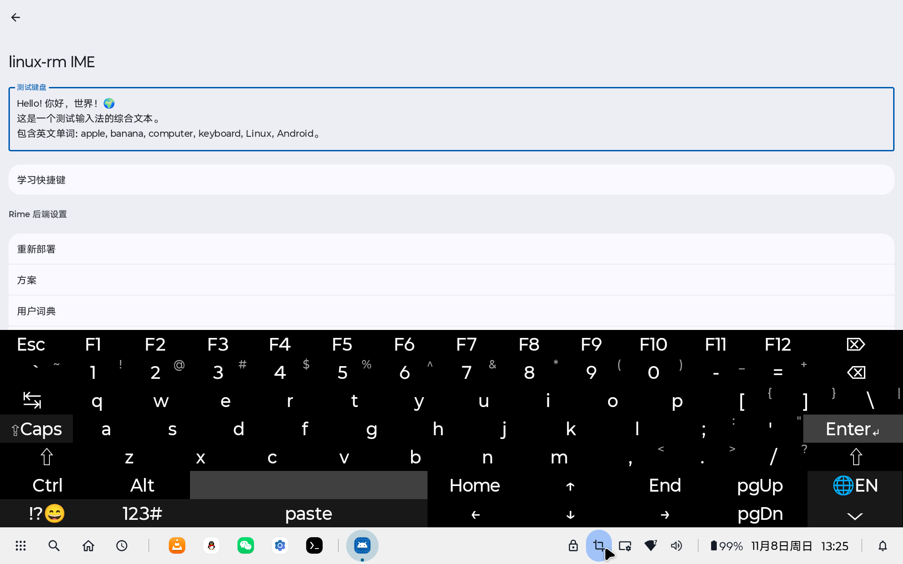
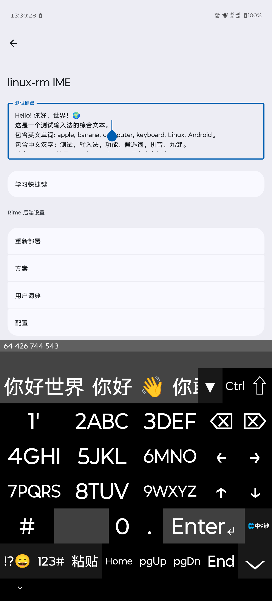
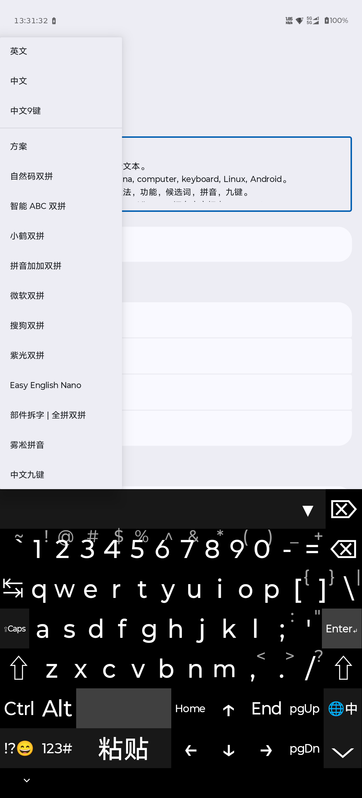
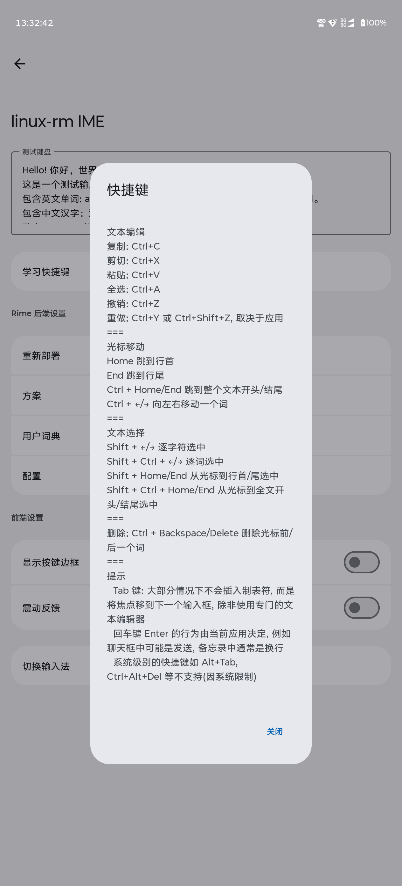
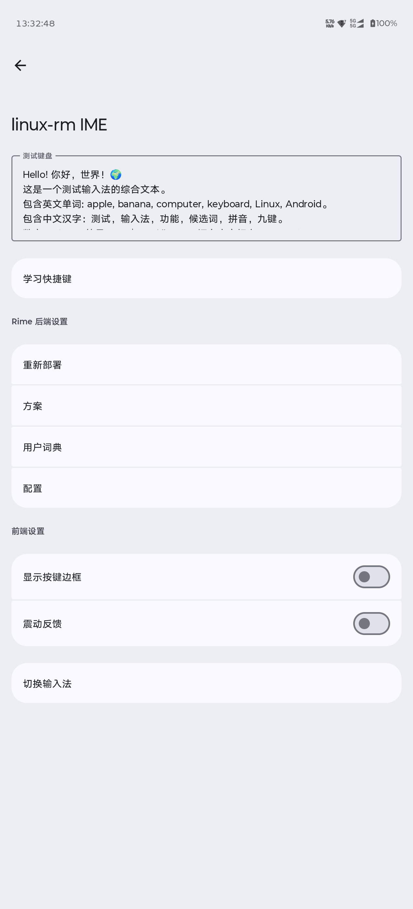

# Linux-rm IME

**Linux-rm IME** is an Android Input Method Editor (IME) that emulates a full PC keyboard layout, with Chinese input powered by [Rime](https://github.com/rime/librime). It offers a physical-keyboard-like typing experience with modifier keys (Shift, Ctrl, Alt), a numeric keypad mode, a function-key row, symbol input, and a candidate bar for Rime-based Chinese input.

Tablet:



Phone:



## Features

- **Full PC keyboard layout** – letters, digits, symbols, F1–F12, arrow keys, Home/End, Page Up/Down, etc.
- **Modifier keys** – Shift (sticky/latching), Ctrl, Alt; supports combinations such as Ctrl+A, Ctrl+C, Ctrl+V.
- **Function keys row** – Esc and F1–F12 are on the top row in English mode.
- **Numeric keypad mode** – toggle to a numpad layout with operators and navigation keys.
- **Caps Lock** – on-screen indicator, mapped to the system caps state.
- **Chinese input via Rime** – pinyin and T9 (nine-key) modes, schema switching, user dictionary, candidate selection and deletion.
- **English mode** – plain PC keyboard layout; keys are committed or sent as key events directly, without going through Rime.
- **Symbol input** – categorized symbol picker loaded from `res/raw/symbols.csv`.
- **Candidate bar** – shows Rime candidates in Chinese and T9 modes; hidden in English, password, and numeric fields.
- **Editing helpers** – dedicated paste key; select-all / copy / cut via Ctrl+A / Ctrl+C / Ctrl+X.
- **Adaptive layout** – automatically switches to a numeric keyboard in numeric fields and hides Rime features in password fields.
- **Frontend settings** – toggle key borders and haptic feedback. Rime configuration / redeploy / user dictionary / schema controls are planned but not yet implemented.
- **Lightweight runtime** – no extra runtime services; Rime is compiled into the app as a native library.

## Requirements

- **Android 6.0+** (`minSdk 23`)
- **JDK 21** (project toolchain)
- **Android SDK 37** (`compileSdk` / `targetSdk`)
- **Android NDK + CMake** (for building the native Rime backend)
- Supported ABIs: `arm64-v8a`, `x86_64`

## Build & Install

### 1. Clone with submodules

> **Note for users in mainland China:** the main repo is on Gitee, but submodules and Boost are on GitHub. If clone hangs, configure a mirror first:
>
> ```bash
> git config --global url."https://v4.gh-proxy.org/https://github.com/".insteadOf "https://github.com/"
> ```

Submodules: `librime/deps/*` (glog, leveldb, yaml-cpp, googletest, marisa-trie, OpenCC), `snappy`, and `jni/OpenCC`.

```bash
git clone --recurse-submodules https://gitee.com/linux-rm/linux-rm-IME.git
```

- or, if already cloned:

```bash
git submodule update --init
```

### 2. Fetch Boost

Boost is not vendored in the repository. It must be cloned into `app/src/main/jni/boost`:

```bash
cd app/src/main/jni
rm -rf boost
git clone --depth 1 --recurse-submodules https://github.com/boostorg/boost.git boost
```

Boost has many submodules; the first clone may take several minutes.

If Boost is missing or incomplete, CMake will abort with a clear error message during the Gradle build.

### 3. Build

Open the project in Android Studio, or build from the command line:

```bash
./gradlew assembleDebug
```

The APK is generated at `app/build/outputs/apk/debug/`.

### 4. Install & enable

Install the APK on your device, then open the app and follow the prompts:

1. Grant storage permission (for the Rime working directory `/sdcard/linux-rm-ime`).
2. Enable **linux-rm IME** in system settings.
3. Select it as the default input method.

## Usage

- **Modifier keys** – tap Shift/Ctrl/Alt once to latch (sticky); tap again to release. Long-press (>300 ms) to release immediately without latching.
- **Language / schema** – long-press the spacebar to open a menu for switching between English, Chinese, Chinese T9, and installed Rime schemas.
- **Numeric keypad** – tap `123#` to toggle the numpad layout.
- **Candidates** – the candidate strip appears above the keyboard while typing; tap a candidate to commit it, long-press to delete it from the user dictionary.
- **Full candidate panel** – tap `▼` to show all candidates in a scrollable panel.
- **Symbols** – tap `!?😄` to open the symbol picker.
- **Paste** – tap `粘贴` / `paste` to paste the current clipboard content.
- **Shortcuts** – open **学习快捷键** from the app settings for a list of supported editing shortcuts.
- **Rime config (planned)** – redeploy, schema switching, user dictionary management, and configuration are not implemented yet; the corresponding rows in the app settings are placeholders for future work.
- **Hide keyboard** – tap `⌵`.

## Project Structure

```
app/
├── src/main/
│   ├── java/com/linuxrm/IME/
│   │   ├── MainActivity.kt            # Settings / setup UI (Jetpack Compose)
│   │   ├── PCKeyboardIME.kt           # IME service: keyboard, candidates, input handling
│   │   ├── SymbolProcessor.kt         # Symbol picker backed by res/raw/symbols.csv
│   │   ├── Theme.kt                   # Compose theme & grouped-list primitives
│   │   └── core/
│   │       ├── Rime.kt                # Rime JNI facade
│   │       ├── RimeApi.kt             # Rime API interface
│   │       ├── RimeConfig.kt          # Rime config reader
│   │       ├── RimeDispatcher.kt      # Single-threaded Rime dispatcher
│   │       ├── RimeKeyEvent.kt        # Key repr parsing (native)
│   │       ├── RimeLifecycle.kt       # Lifecycle registry
│   │       ├── RimeMessage.kt         # Event message model
│   │       ├── RimeProto.kt           # Data classes passed across JNI
│   │       ├── RimeSchema.kt          # Schema metadata
│   │       ├── KeyModifier.kt         # Modifier / meta-state mapping
│   │       ├── KeyValue.kt            # Key value wrapper
│   │       └── SchemaItem.kt
│   ├── jni/
│   │   ├── CMakeLists.txt             # Top-level native build
│   │   ├── cmake/                     # Find* modules and Rime helpers
│   │   ├── librime_jni/               # JNI bridge (C++)
│   │   ├── librime/                   # librime source (deps are submodules)
│   │   ├── librime-lua/               # Lua plugin
│   │   ├── librime-lua-deps/          # Bundled Lua 5.3 / 5.4
│   │   ├── librime-octagram/          # Octagram grammar plugin
│   │   ├── librime-predict/           # Predict plugin
│   │   ├── snappy/                    # submodule
│   │   ├── OpenCC/                    # submodule
│   │   └── boost/                     # fetched manually (see above)
│   ├── assets/rime_shared/            # Default Rime schemas, dictionaries, Lua filters
│   ├── res/
│   │   ├── raw/symbols.csv
│   │   ├── values/strings.xml
│   │   ├── values/themes.xml
│   │   └── xml/method.xml             # IME metadata
│   └── AndroidManifest.xml
├── build.gradle.kts
└── ...
```

## Third-party

| Component | Source | How it is managed |
|---|---|---|
| librime | https://github.com/rime/librime | Vendored in `jni/librime` |
| glog, leveldb, yaml-cpp, googletest, marisa-trie, OpenCC | upstream repos | Git submodules under `jni/librime/deps/` |
| snappy | https://github.com/google/snappy | Git submodule |
| OpenCC (standalone) | https://github.com/BYVoid/OpenCC | Git submodule |
| Boost | https://github.com/boostorg/boost | Cloned manually into `jni/boost` (see Build) |
| Lua 5.3 / 5.4 | https://www.lua.org | Vendored in `jni/librime-lua-deps` |

## License

[GPL-3.0](LICENSE)
