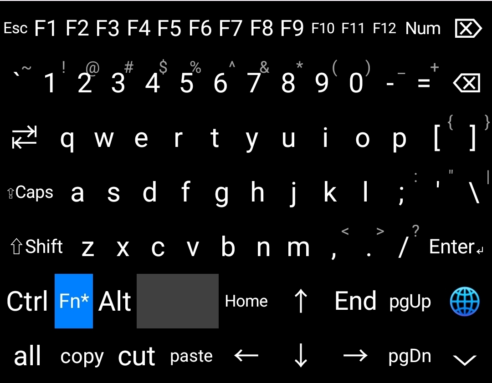

# Linux-rm IME

**Linux-rm IME** is an Android Input Method Editor (IME) that emulates a full PC keyboard layout. It offers a physical‑keyboard‑like typing experience with support for modifier keys (Shift, Ctrl, Alt), an Fn layer, a numeric keypad mode, and common editing shortcuts.



## Features

- **Full PC keyboard layout** – letters, digits, symbols, function keys (F1–F12), arrow keys, Home/End, Page Up/Down, etc.
- **Modifier keys** – Shift (sticky/latching), Ctrl, Alt, Meta; supports key combinations (e.g., Ctrl+A for select all, Ctrl+C for copy).
- **Fn layer** – one‑tap switch to the function‑key row (Esc, F1–F12, Del, etc.).
- **Numeric keypad mode** – toggle to a numpad layout for quick number and operator entry.
- **Candidate bar** – shows word suggestions while typing (automatically hidden in password fields).
- **Editing helpers** – one‑tap select all, copy, cut, paste with clipboard integration.
- **Adaptive input type** – automatically switches behaviour/layout based on the input field (text, password, number).
- **Lightweight** – ~300 lines of core code with no extra dependencies.

## Requirements

- Android SDK 26+ (Android 8.0 Oreo and above)
- Gradle 9.6.1 (as configured)

## Build & Install

1. Clone or download the source code.
2. Open the project in Android Studio, or build from the command line:
   ```bash
   ./gradlew assembleDebug
   ```
3. The APK will be generated at `app/build/outputs/apk/debug/`. Install it on your device.
4. In system settings, enable and select Linux-rm IME as the default input method (the app will guide you through the process).

## Usage

- On first launch, the app will prompt you to enable and choose Linux-rm IME as the default keyboard.
- Once set, the keyboard will appear automatically in any text input field.
- **Modifier keys**: Tap Shift/Ctrl/Alt once to activate temporarily (sticky); tap again to deactivate. Long‑press (>300ms) to release immediately (no lock).
- **Fn toggle**: Tap the `Fn` key to switch to the function‑key layer; tap again to return.
- **Num toggle**: Tap the `Num` key to switch to the numeric keypad; tap again to return.
- **Candidates**: When typing, a candidate bar appears above the keyboard – tap a word to insert it.
- **Hide keyboard**: Tap the `⌵` button at the bottom right corner.

## Project Structure

```
app/
├── src/main/
│   ├── java/com/linuxrm/IME/
│   │   ├── MainActivity.kt          # Setup wizard activity
│   │   └── PCKeyboardIME.kt          # IME core logic
│   ├── res/
│   │   ├── layout/activity_main.xml
│   │   ├── values/strings.xml
│   │   ├── values/themes.xml
│   │   └── xml/method.xml            # IME metadata
│   └── AndroidManifest.xml
├── build.gradle.kts
└── ...
```

## License

GPL3.0

---

**Note:** This IME is primarily a demo for Android IME development. Some features (e.g., the candidate list) are minimal examples and can be extended as needed.
